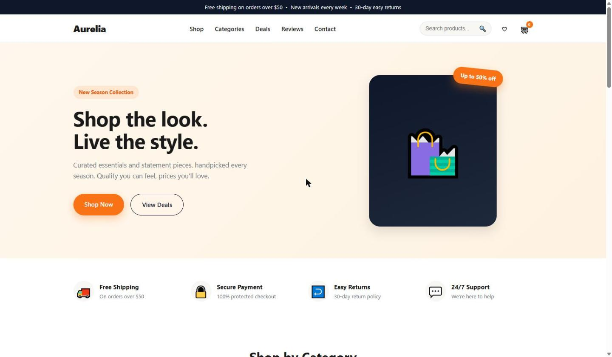

# Aurelia - Multi-page E-commerce Storefront Template

A free, responsive online store template built with plain HTML5, CSS3 and JavaScript. No frameworks, no build step. It has every page a real shop needs, a cart that works and a full checkout flow, ready to download and adapt.



**[Live demo](https://lenivalestevao.github.io/ecommerce-storefront-landing/)**

## Pages

All pages run in a single `index.html` and are routed with the URL hash (for example `#/shop`), so it works on any static host such as GitHub Pages.

| Page | Route | What it does |
| --- | --- | --- |
| Home | `#/` | Hero slider, trust bar, categories, featured products carousel, flash sale with countdown, testimonials carousel, newsletter |
| Shop | `#/shop` and `#/shop/Women` | Category sidebar, live search, price slider, on-sale filter and sorting |
| Product | `#/product/1` | Gallery, color and size pickers, quantity, reviews and related products |
| Cart | `#/cart` | Quantity controls, remove, promo code and shipping rule |
| Checkout | `#/checkout` | Contact, address, delivery and demo payment form with validation |
| Order confirmation | `#/success` | Order number and summary after placing an order |
| Wishlist | `#/wishlist` | Saved products |
| Account | `#/account` | Sign in, create account and order history (demo, stored in your browser) |
| About, Contact, FAQ | `#/about` `#/contact` `#/faq` | Content pages with a contact form and accordion |
| Privacy, Terms | `#/privacy` `#/terms` | Sample legal pages |
| 404 | any unknown route | Friendly not-found page |

There is also a slide-in cart drawer, wishlist and cart counters in the header, toast messages and a mobile off-canvas menu.

## Try it

- Add products to the cart and open **Checkout**. Any values work, no payment is processed.
- Use the promo code `AURELIA10` in the cart for 10% off.
- Shipping is free over $50, otherwise $6. Express is $15.

## Structure

```
index.html   # page shell: header, footer, cart drawer
style.css    # all styles, responsive down to small phones
script.js    # router, pages, catalog data, cart, wishlist, checkout
```

## Customize

- **Products and categories:** edit the `P` and `CATS` arrays at the top of `script.js`.
- **Colors:** change the CSS variables in `:root` at the top of `style.css` (the accent color is `--accent`).
- **Brand and text:** replace "Aurelia" in `index.html` and the copy inside the page functions in `script.js`.
- **Real data:** the catalog is a local array, so connect it to your own API or store back end when you are ready.

Cart, wishlist and the demo account are kept in `localStorage`. Checkout and sign in are demos only, so add a real back end and payment provider before going live.

## License

MIT
